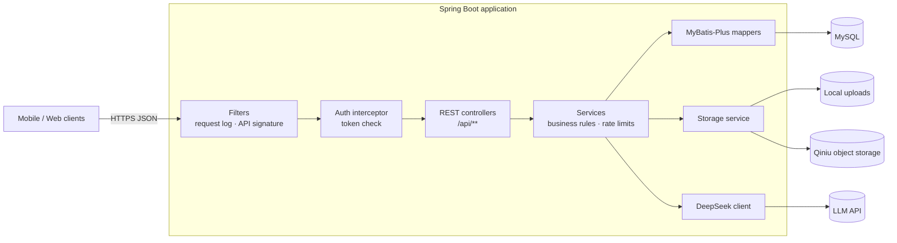

# UGC Community Backend

A production-style REST API for a user-generated content (UGC) community: users publish
illustrated works, tag and comment on them, follow each other, curate collections, earn
achievements, and build fictional worlds in a "sandbox" module with optional AI assistance.

Built with **Spring Boot 2.6 + MyBatis-Plus + MySQL**. It served native Android and iOS
clients in production; only the backend is published here.

## Features

- **Accounts** – registration, login, profile, avatar/background, follow/unfollow, bound phone & email
- **Content** – works (text + images/video), tags, comments, likes, favorites, view history, pins, reports
- **Curation** – user collections and favorite folders, tag subscriptions and tag blocking
- **Growth system** – achievements, crystals, virtual cats, "resonance" between works
- **Messaging** – private messages and system notifications
- **Sandbox (world-building)** – world groups, worldviews, characters & folders, relationship
  graph with saved layouts, records, maps, timelines, auto-organize, AI chat (DeepSeek-compatible API)
- **Media pipeline** – local disk or Qiniu object storage, image compression and thumbnails,
  optional FFmpeg video compression
- **App management** – version check / forced update, per-app identity and signing configuration
- **Moderation** – banned-word filtering, reports, feedback

## Architecture



Layered layout under `src/main/java/com/ugccommunity/backend`:

| Package | Responsibility |
| :--- | :--- |
| `controller` | REST endpoints, request validation |
| `service` | Business logic, transactions, rate limiting, AI and storage integration |
| `mapper` / `entity` | MyBatis-Plus data access |
| `dto` / `vo` | Request and response models |
| `common.config` | Web config, filters, schema initializers |
| `common.upload` | Upload validation, compression, storage backends |
| `common.result` / `common.exception` | Unified `Result<T>` envelope and error codes |

## Tech stack

Java 8+ (tested on JDK 17) · Spring Boot 2.6.13 · Spring MVC · Bean Validation ·
MyBatis-Plus 3.5.5 · MySQL 8 · H2 (tests) · Qiniu SDK · FFmpeg (optional) · JUnit 5 · Maven

## API overview

All endpoints return `{"code": ..., "message": ..., "data": ...}`. Except where noted,
they require `Authorization: Bearer <token>`.

| Area | Base path | Endpoints |
| :--- | :--- | ---: |
| Health / heartbeat (public) | `/api/health`, `/api/heartbeat` | 2 |
| Auth (public) | `/api/auth/login`, `/register`, `/reset-password` | 3 |
| CSRF token (public) | `/api/csrf-token` | 1 |
| App version check (public) | `/api/app/check-update` | 1 |
| Users | `/api/users` | 14 |
| Works | `/api/works` | 19 |
| Work collections | `/api/collections` | 11 |
| Favorite folders | `/api/favorite-collections` | 9 |
| Tags | `/api/tags` | 8 |
| Messages | `/api/messages` | 4 |
| Pins | `/api/pins` | 3 |
| Feedback | `/api/feedback` | 2 |
| Growth | `/api/growth` | 10 |
| Upload | `/api/upload` | 1 |
| Sandbox | `/api/sandbox` | 78 |

Uploaded files are served from `/uploads/**`.

## Security design

- **Fail-fast secrets** – no credentials are hard-coded. The app refuses to start unless
  `DB_USERNAME`, `DB_PASSWORD` and a `JWT_SECRET` of at least 32 characters are provided.
- **Signed tokens** – stateless tokens (`base64(userId:username:expiresAt).HMAC-SHA256`)
  with expiry; verified by an interceptor on every `/api/**` route.
- **Password hashing** – PBKDF2-HMAC-SHA256, 120,000 iterations, 16-byte random salt;
  a startup runner migrates legacy hashes.
- **Optional request signing** – official clients sign each request (HMAC over method,
  path, timestamp, nonce and body with a per-app secret; replay protection via nonce cache
  and clock-skew window). Responses can be signed with an RSA private key so clients can
  detect tampering. Toggle with `API_SIGNATURE_ENABLED`.
- **CSRF tokens** for auth endpoints, issued per app via `/api/csrf-token` (`X-CSRF-Token`).
- **Rate limiting** per IP and per account for login, registration, uploads, publishing,
  comments and other actions.
- **Upload validation** – extension/MIME/magic-byte checks, size limits, randomized names.
- **Audit log** – API requests are recorded in `api_request_log` (sensitive fields masked).
- **Proxy awareness** – `X-Forwarded-For` is trusted only when `TRUST_PROXY=true`.
- **CORS** restricted to `CORS_ALLOWED_ORIGINS`.
- **Password reset by contact** (username + phone + email, no OTP) is **disabled by default**
  (`PASSWORD_RESET_BY_CONTACT_ENABLED=false`); add an OTP step before enabling it.

## Quick start

Requirements: JDK 8+ (17 recommended), Maven 3.8+, MySQL 8.

```bash
# 1. Database
mysql -u <admin-user> -p < sql/schema.sql
for f in src/main/resources/db/migration/*.sql; do mysql -u <admin-user> -p ugc_community < "$f"; done
mysql -u <admin-user> -p ugc_community < sql/seed-demo.sql   # optional demo data

# 2. Configuration
cp .env.example .env
# edit .env: DB_USERNAME, DB_PASSWORD, JWT_SECRET (openssl rand -base64 48)

# 3. Run
set -a; . ./.env; set +a
mvn spring-boot:run
# or: mvn -DskipTests package && scripts/run-app.sh

curl http://localhost:8080/api/health
```

Demo users: `alice` / `bob` / `carol`, password `demo-password-change-me`.

### Environment variables

| Variable | Required | Default | Description |
| :--- | :---: | :--- | :--- |
| `DB_URL` | | `jdbc:mysql://localhost:3306/ugc_community?...` | JDBC URL |
| `DB_USERNAME` | ✓ | – | Database user |
| `DB_PASSWORD` | ✓ | – | Database password |
| `JWT_SECRET` | ✓ | – | Token signing secret, ≥ 32 random characters |
| `CORS_ALLOWED_ORIGINS` | | `http://localhost:3000` | Comma-separated origins |
| `TRUST_PROXY` | | `false` | Trust `X-Forwarded-For` (only behind your own proxy) |
| `RATE_LIMIT_ENABLED` | | `true` | Enable rate limits |
| `PASSWORD_RESET_BY_CONTACT_ENABLED` | | `false` | Enable the OTP-less reset endpoint |
| `API_SIGNATURE_ENABLED` | | `false` | Require signed requests from clients |
| `API_SIGNATURE_PUBLIC_KEY` | | – | RSA public key for signature setup |
| `UGC_UPLOAD_DIR` | | `./uploads` | Local upload directory |
| `QINIU_ENABLED`, `QINIU_ACCESS_KEY`, `QINIU_SECRET_KEY`, `QINIU_BUCKET`, `QINIU_DOMAIN` | | disabled | Qiniu object storage |
| `DEEPSEEK_API_KEY`, `DEEPSEEK_BASE_URL`, `DEEPSEEK_MODEL` | | – | AI chat in the sandbox module |

See `.env.example` and `src/main/resources/application-example.yml`.

### App identities

There is no admin UI in this repository. App identities (`app_identity`) and releases
(`app_release`) are managed directly in the database; see the placeholder row in
`sql/seed-demo.sql`.

## Tests

```bash
mvn test
```

Tests run against an in-memory H2 database and do not need MySQL.

## License

[MIT](LICENSE) © 2026 zhu chunhao
